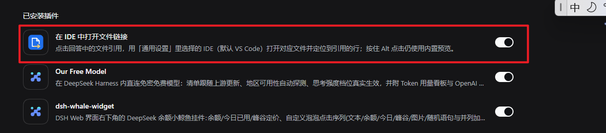
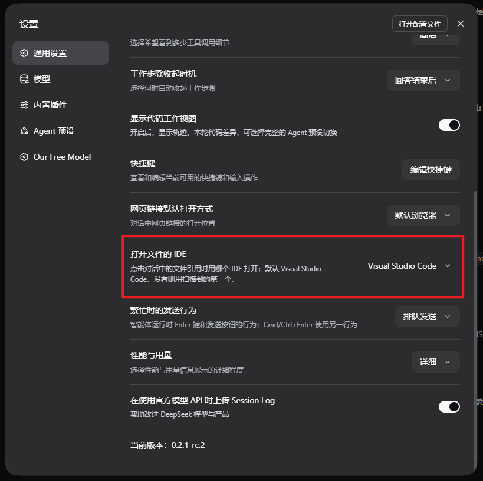

# dsh-open-in-ide

**English** | [中文](README.zh.md)

Open file references from the [DeepSeek Harness](https://github.com/deepseek-ai/deepseek-harness)
chat in your IDE — **Visual Studio Code by default**, or any detected VS Code
family / JetBrains IDE — positioned at the referenced line, instead of the in-app
document preview.

A DeepSeek Harness plugin (bundle + browser half). Tested with DeepSeek Harness
`0.2.1-rc.2` (Desktop / Web profile).

Supported editors, detected on the machine hosting the Harness:

* **VS Code family** (`--goto <path>:<line>:<column>`): Visual Studio Code,
  VS Code Insiders, Cursor, Windsurf.
* **JetBrains family** (`--line <line> <path>`): IntelliJ IDEA, PyCharm, WebStorm,
  GoLand, CLion, PhpStorm, Rider, RubyMine, DataGrip, RustRover.

## Where to find it

After installing the bundle, reload the Harness page once.

### 1. Enable it — Settings → Plugins → Installed plugins (已安装插件)



The bundle appears as **“Open File Links in Your IDE”** (Chinese UI:
“在 IDE 中打开文件链接”) with its on/off switch.

### 2. Choose your IDE — Settings → General → “IDE for file links” (打开文件的 IDE)



The row lists only the IDEs detected on the machine hosting the Harness;
**Visual Studio Code is the default**, and the first detected IDE is used when
VS Code is not installed.

## Features

* **Plain click** on a file-reference chip in an assistant message opens that
  file in the selected IDE at the referenced line.
* After opening, the editor window is **brought to the foreground** (and restored
  if it was minimized). Windows uses a small Win32 helper to defeat the
  background-process foreground lock; macOS activates via `osascript`; Linux
  tries `wmctrl`/`xdotool`.
* **Two editor families**: VS Code / VS Code Insiders / Cursor / Windsurf are
  launched with `--goto`; JetBrains IDEs (IntelliJ IDEA, PyCharm, WebStorm,
  GoLand, CLion, PhpStorm, Rider, RubyMine, DataGrip, RustRover) with
  `--line <line> <path>`. The browser only names an editor id from a fixed set.
* **Settings → General → “IDE for file links”** lists only the IDEs the host can
  actually launch, detected by scanning known install locations and `PATH` on
  every request. The default is Visual Studio Code; when it is not installed the
  first detected IDE is used, and a saved choice that is no longer installed is
  reconciled the same way.
* Clicking a **directory** reference opens it as a workspace folder.
* **Alt / Shift / Ctrl + click** keeps the shipped in-app preview.
* A toast names the target and the IDE, including failures (missing file,
  uninstalled editor, launch error).
* No build step, no dependencies, no telemetry. The browser half ships as the
  package's `./client` export; the host half only uses Node built-ins.

## Requirements

* A DeepSeek Harness Web GUI (Desktop or a `web` profile). The host composition
  must provide `webServer`, `connection`, `subprocess`, `fs`, and `sessions`;
  the desktop and web profiles do.
* At least one supported IDE:
  * **VS Code family**: Visual Studio Code, VS Code Insiders, Cursor, Windsurf.
  * **JetBrains family**: IntelliJ IDEA, PyCharm, WebStorm, GoLand, CLion,
    PhpStorm, Rider, RubyMine, DataGrip, RustRover.
* Compatibility note: the browser half keys off the shipped chat's
  file-reference chip markup (`_fileMention_*` buttons with the authored path in
  `title`). A future Harness UI change may need an update here; pin or report
  the Harness version when filing an issue.

## Install

The plugin is a standard DSH bundle, installed through the Plugin Manager
(Settings → Plugins) or the `plugin_manager` tool. A local directory install
links the checkout, so later edits apply live.

1. Clone the repository:

   ```bash
   git clone https://github.com/harrithy/dsh-open-in-ide.git
   ```

2. Install the bundle from that directory. In the Harness, either use
   **Settings → Plugins → install**, or ask the agent to run the
   `plugin_manager` tool with `action: install_bundle` and this absolute
   directory as `target`. A `link:` install from the profile's package manager
   works too:

   ```bash
   dsh plugin --profile <profile> add link:/path/to/dsh-open-in-ide
   ```

3. **Reload the Harness page** (`F5`). The bundle `dsh-open-in-ide` and row
   `open-in-ide` appear in Plugin Manager, and a new row appears in
   Settings → General (see [Where to find it](#where-to-find-it)).

## Usage

* Click a file reference such as `src/app.ts:42` in an answer. The file opens in
  the selected IDE at line 42.
* Choose the IDE in **Settings → General → “IDE for file links”**. The row lists
  the IDEs detected on the machine hosting the Harness.
* The choice is stored in the browser (`localStorage`, key
  `dsh.open-in-ide.editor`); the legacy key of the plugin's former name is read
  once for migration.
* Line/column come from a `:42` / `:42:7` suffix in the chip label. The harness
  exposes only the path as a DOM attribute, so the label is the line channel.
  Absolute and workspace-relative paths are both accepted; relative paths
  resolve against the Session's workspace directory on the host.
* The column (when present) is only forwarded to VS Code-family launchers;
  JetBrains launchers receive the line only.
* Directories open as workspace folders.

## Configuration

The row config lives in `cordis.patch.yml`; override it in the profile's own
`cordis.patch.yml` to tune behavior (the user patch layer survives plugin
updates):

```yaml
- id: open-in-ide
  config:
    command: 'C:\Users\me\AppData\Local\Programs\Microsoft VS Code\bin\code.cmd'
    reuseWindow: true
```

| Field | Default | Meaning |
|---|---|---|
| `command` | `''` | Explicit editor CLI: a bare PATH name (`code`) or an absolute path (`...\bin\code.cmd`). When set it wins over the Settings selector; empty keeps the selector authoritative. |
| `commandKind` | `vscode` | Launcher contract used for a configured `command`: `vscode` (`--goto`) or `jetbrains` (`--line`). Ignored while `command` is empty. |
| `editor` | `vscode` | Fallback IDE when a request carries no selection: any supported id, e.g. `vscode`, `cursor`, `idea`, `pycharm`, `webstorm`. |
| `reuseWindow` | `false` | Add `--reuse-window` so the file opens in the most recent window (VS Code family only). VS Code already routes files into a window that has the containing folder open. |
| `focusWindow` | `true` | Bring the editor window to the foreground after opening it (restore if minimized). Disable to let the OS decide. |
| `focusDelayMs` | `350` | Delay before the first foreground attempt; when a cold-started editor has no window yet the plugin retries a few times. |
| `extraArgs` | `[]` | Extra arguments placed before the target arguments, e.g. `["-n"]`. |
| `launchWatchMs` | `2000` | Early-failure watch window for the detached launcher; a launcher still running when it closes counts as launched. |

## Detection and launch resolution

The host serves two routes, both fenced by the composition's connection trust
checks (Host/Origin fence plus browser authentication):

* `GET /open-in-ide/editors` — probes each supported editor id on every request
  (cheap existence checks plus in-process `PATH` lookups) and answers which ones
  this host can launch.
* `POST /open-in-ide/open` — validates `{ sessionId, path, line, column,
  editor }`, resolves the path in the Session's workspace, then launches the
  selected editor detached with the family's contract and a credential-scrubbed
  environment.

Detection order:

* **Windows**:
  * VS Code family: known install roots under `%LOCALAPPDATA%` / `%ProgramFiles%`,
    then the IDE's CLI name on `PATH`. A machine where Cursor registered itself
    as `code` still resolves the `vscode` id to the real VS Code install,
    because known roots are tried before `PATH`.
  * JetBrains: Toolbox launcher scripts
    (`%LOCALAPPDATA%\JetBrains\Toolbox\scripts\<cli>.cmd`), Toolbox apps
    (`…\Toolbox\apps\<app>\ch-<n>\<version>\bin\<exe>`), standalone installs
    (`%ProgramFiles%\JetBrains\<Product 2024.x>\bin\<exe>`), then the CLI name
    on `PATH`.
* **macOS**: VS Code family uses the `.app` bundle's
  `Contents/Resources/app/bin/<cli>`; JetBrains uses
  `<App>.app/Contents/MacOS/<cli>`. Both fall back to `PATH`.
* **Linux**: known install paths (`/opt/...`, `/usr/bin/...`, snap paths) and the
  JetBrains Toolbox scripts directory under `~/.local/share/JetBrains`, then
  `PATH`.

The browser never sends a command line: it names an editor id from a fixed set,
and the host resolves it to an executable it verified.

## Limits

* Only the shipped Markdown file-reference chips are redirected. Tool-call card
  file names, delivered-file cards, and the document preview keep their own
  openers.
* Supported editors and their launcher contracts: VS Code family
  (`--goto <path>:<line>:<col>`) and the JetBrains family
  (`--line <line> <path>`). A custom `command` must accept the contract named by
  `commandKind`.
* Detection covers the editor ids listed above. A portable build not on `PATH`,
  or an editor outside those families, needs `command`.
* The column (when present) is only forwarded to the VS Code family; JetBrains
  launchers receive the line only.
* Window raising is best-effort: Windows uses a Win32 helper (an unusual
  foreground policy or security tool can still refuse the change), while macOS
  and Linux depend on `osascript` / `wmctrl` / `xdotool` being available.
* Line/column come from the visible chip label; when a link's label does not
  repeat the line, the file opens without a line target.
* The editor choice is per browser (`localStorage`); another browser or origin
  keeps its own choice.

## Development

```text
index.js               Host half: detection + open routes, launch logic
client.js              Browser half: settings row, click bridge, toasts
cordis.patch.yml       Bundle row declaration + defaults
locale/{en,zh}.json    Plugin Manager title/description
icon.svg               Plugin artwork
docs/                  Screenshots used by this README
```

There is no build step: `index.js` is loaded by the Loader, `client.js` is served
to the browser as the package's `./client` export. A local directory install is
linked into the profile, so editing either file takes effect through HMR (client
immediately; host after the plugin row reloads).

## License

MIT — see [LICENSE](LICENSE).
