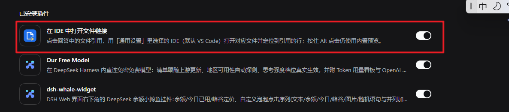
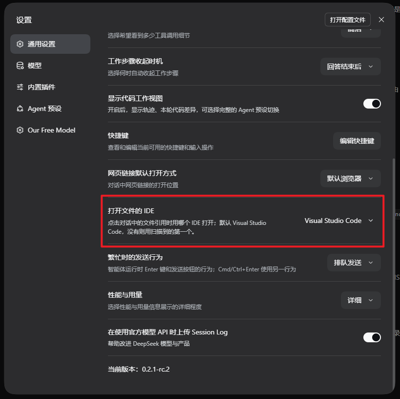
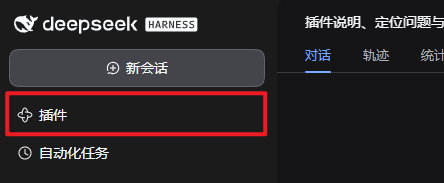
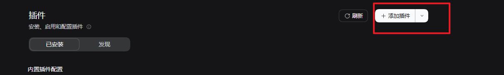
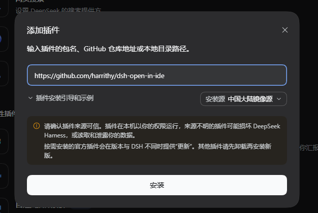

# dsh-open-in-ide

[](https://www.npmjs.com/package/dsh-open-in-ide)
[](LICENSE)

[English](README.md) | **中文**

点击 [DeepSeek Harness](https://github.com/deepseek-ai/deepseek-harness) 对话中
回答里的文件引用，用你选择的 IDE（**默认 Visual Studio Code**，也支持 VS Code
家族与 JetBrains 系列）打开对应文件并定位到引用的行，替代内置的文档预览。

一个 DeepSeek Harness 插件（bundle + 浏览器半）。已在 DeepSeek Harness
`0.2.2-rc.1`（桌面版 / Web profile）上测试。

支持的编辑器（在宿主机器上自动检测）：

* **VS Code 家族**（`--goto <path>:<line>:<column>`）：Visual Studio Code、
  VS Code Insiders、Cursor、Windsurf。
* **JetBrains 家族**（`--line <line> <path>`）：IntelliJ IDEA、PyCharm、
  WebStorm、GoLand、CLion、PhpStorm、Rider、RubyMine、DataGrip、RustRover。

## 在界面中的位置

安装 bundle 后，刷新一次 Harness 页面。

### 1. 启用插件 —— 插件页 → 已安装



插件在已安装列表中显示为 **「在 IDE 中打开文件链接」**，右侧开关用于启用/停用。

### 2. 选择 IDE —— 设置 → 通用设置 →「打开文件的 IDE」



下拉只列出本机检测到的 IDE；**默认 Visual Studio Code**，未安装 VS Code 时使用
扫描到的第一个。已保存的选择如果后来被卸载，也会自动回退到 VS Code 或第一个
检测到的 IDE。

## 功能

* **单击**回答中的文件引用 chip，用所选 IDE 打开对应文件并定位到引用的行。
* 单击本轮**「已编辑文件」卡片**里的文件行，也会用所选 IDE 打开该文件；卡片标题和
  「展开/收起」仍打开右侧的审查页。
* **连同项目一起打开**：VS Code 家族会沿路径向上找项目根（`.git`/`.hg`，否则
  `package.json`、`Cargo.toml`、`pom.xml` 等标记），把项目目录作为文件夹参数传
  给 CLI，于是 VS Code 会**打开或复用项目窗口**，而不是把文件变成散落标签塞进最近
  使用的窗口。没有任何项目标记的文件仍按原方式打开。
* 打开后会把 IDE 窗口**提到最前**（窗口最小化时先恢复）。Windows 会先用系统自带
  的 .NET Framework 编译器把一个小型 Win32 助手编译成 exe，之后每次只运行这个
  exe；它会在窗口出现后立即轮询并置前（没有编译器时回退到 PowerShell 脚本）。
  macOS 用 `osascript` 激活应用；Linux 尝试 `wmctrl` / `xdotool`。置前在后台执行，
  点击会先返回“已打开”，不等窗口出现。
* **两个编辑器家族**：VS Code / Insiders / Cursor / Windsurf 用 `--goto` 启动；
  JetBrains（IntelliJ IDEA、PyCharm、WebStorm、GoLand、CLion、PhpStorm、Rider、
  RubyMine、DataGrip、RustRover）用 `--line <行> <路径>` 启动。浏览器只发送固定
  集合里的编辑器 id。
* **设置 → 通用设置 →「打开文件的 IDE」**只列出宿主真正能启动的 IDE（每次请求
  都会扫描已知安装位置和 `PATH`）。默认 VS Code；没有 VS Code 则用扫描到的第一
  个；已保存的选择失效时同样自动回退。
* 点击**目录**引用会在 IDE 中打开该文件夹。
* **Alt / Shift / Ctrl + 单击**保留内置行为：文件引用走侧栏预览，已编辑文件行走
  右侧审查页。
* 顶部 toast 提示目标与 IDE，失败时给出原因（文件不存在、IDE 未安装、启动失败）。
* 无构建步骤、无依赖、无遥测。浏览器半以包的 `./client` 导出提供，宿主半只使用
  Node 内置模块。

## 环境要求

* 一个 DeepSeek Harness Web GUI（桌面版或 `web` profile）。宿主组合需要提供
  `webServer`、`connection`、`subprocess`、`fs`、`sessions` 服务；桌面版与 web
  profile 都满足。
* 至少安装一款受支持的 IDE：
  * **VS Code 家族**：Visual Studio Code、VS Code Insiders、Cursor、Windsurf。
  * **JetBrains 家族**：IntelliJ IDEA、PyCharm、WebStorm、GoLand、CLion、
    PhpStorm、Rider、RubyMine、DataGrip、RustRover。
* 兼容性说明：浏览器半依赖当前聊天 UI 的文件引用 chip 结构（`_fileMention_*`
  按钮，作者路径在 `title` 属性里）。Harness 未来的 UI 改动可能需要适配；提
  issue 时请附上 Harness 版本。

## 安装

插件已发布到 npm：[`dsh-open-in-ide`](https://www.npmjs.com/package/dsh-open-in-ide)，
是标准 DSH bundle，通过 Plugin Manager（左侧边栏的**插件**页）或
`plugin_manager` 工具安装。

### 通过插件管理器安装

Harness 左侧边栏的**插件**页就是插件管理器。打开它，点右上角 **+ 添加插件**，在输入框
里填下面任意一种：

* npm 包名：`dsh-open-in-ide`
* 本仓库地址：`https://github.com/harrithy/dsh-open-in-ide`
* 本地 checkout 目录的绝对路径







对话框里还可以选择安装源（例如中国大陆镜像源）。只安装你信任的来源：正如弹窗警告
所说，插件会以 Harness 用户的权限运行。下面两种安装方式功能相同，只影响之后的更新
方式——填本地 checkout 路径会按 `link:` 安装并从 GitHub 自动更新；填 npm 包名则在这
个插件页里更新。

### 从 npm 安装（最简单）

在 Harness 里按名字安装：在插件页点 **+ 添加插件**（见上），spec 填
`dsh-open-in-ide`；或让 agent 用 `plugin_manager` 工具执行
`action: install_bundle`，`target: "dsh-open-in-ide"`。也可以用 profile 的包管理器：

```bash
dsh plugin --profile <profile> add dsh-open-in-ide
```

### 从 git checkout 安装（支持自动热更新）

本地目录安装会把源码目录链接进 profile，所以插件可以从 GitHub 自动热更新，改代码
也即时生效。

1. 克隆仓库：

   ```bash
   git clone https://github.com/harrithy/dsh-open-in-ide.git
   ```

2. 从这个目录安装 bundle。可在 Harness 的插件页把该目录的绝对路径填进 **+ 添加插件**
   （见上），或让 agent 用 `plugin_manager` 工具执行 `action: install_bundle`，
   `target` 填这个目录的绝对路径。也可以用 profile 的包管理器做 `link:` 安装：

   ```bash
   dsh plugin --profile <profile> add link:/path/to/dsh-open-in-ide
   ```

3. **刷新 Harness 页面**（F5）。插件页中会出现 bundle `dsh-open-in-ide` 和行
   `open-in-ide`，通用设置里会出现新的一行（见[在界面中的位置](#在界面中的位置)）。

两种安装功能相同，只有「自动更新」不同：git checkout 会从 GitHub 拉取并就地重载，
npm 安装则通过插件页升级。

## 自动更新

当插件是从 **git checkout**（`link:` 安装，见上面的安装步骤）安装时，可以在 Harness
运行期间自行更新：

* 页面每次加载会检查一次配置的仓库（`updateCheck`，默认开启）；**设置 → 通用设置
  →「插件更新」** 一行也可以随时手动检查。
* 远端有新提交时，该行会显示新版本和「更新」按钮。更新会在 checkout 里执行
  `git pull --ff-only`，然后通过 HMR 就地重载插件，**不需要重启 Harness**。
* 更新器只信任配置的 `updateRepository` origin；本地有未提交改动、origin 不匹配、
  或无法快进的历史都会被拒绝。

**包管理器安装**不能用这种方式 pull，但同一行仍会提示 npm 上的新版本：宿主按
`updateRegistry`（默认 `https://registry.npmjs.org`）查询该包的 `latest` 版本并与
已安装版本比较，发现更新时提示去**插件页**升级；页面加载时的后台检查也会 toast
一次。插件本身不会安装任何东西。

git checkout 更新需要 `PATH` 上有 `git` 且能访问仓库；包更新提示需要能访问 npm
registry。

## 使用

* 点击回答里的文件引用（如 `src/app.ts:42`），文件会在所选 IDE 中打开并定位到
  第 42 行。
* 在 **设置 → 通用设置 →「打开文件的 IDE」** 中选择 IDE；下拉只列出宿主检测到
  的 IDE。
* 选择保存在浏览器（`localStorage`，键 `dsh.open-in-ide.editor`）；插件改名前的
  旧键会被读取一次以完成迁移。
* 行号/列号取自 chip 的可见文字：`path:42`、`path:42:7`、`#L42`、`:42–50`
  这类范围（取起始行），或 `第 42 行` / `line 42` 这样的文字标签。Harness 只把
  路径暴露在 DOM 的 `title` 属性中，所以链接文字是行号的唯一通道。绝对路径和
  相对工作区的路径都支持，相对路径由宿主按 Session 的工作目录解析。
* 列号只会传给 VS Code 家族启动器；JetBrains 启动器只接收行号。
* 目录引用会作为工作区文件夹打开。

## 配置

行配置在 `cordis.patch.yml` 中；在 profile 自己的 `cordis.patch.yml` 里覆盖即可
（用户 patch 层在插件升级后仍保留）：

```yaml
- id: open-in-ide
  config:
    command: 'C:\Users\me\AppData\Local\Programs\Microsoft VS Code\bin\code.cmd'
    reuseWindow: true
```

| 字段 | 默认 | 含义 |
|---|---|---|
| `command` | `''` | 显式指定编辑器 CLI：PATH 名（`code`）或绝对路径（`...\bin\code.cmd`）。设置后优先于设置页选择；留空则设置页选择生效。 |
| `commandKind` | `vscode` | 配置了 `command` 时使用的启动约定：`vscode`（`--goto`）或 `jetbrains`（`--line`）。`command` 为空时忽略。 |
| `editor` | `vscode` | 请求未携带选择时的回退 IDE：任意受支持的 id，如 `vscode`、`cursor`、`idea`、`pycharm`、`webstorm`。 |
| `reuseWindow` | `false` | 追加 `--reuse-window`，在最近窗口打开（仅 VS Code 家族）。VS Code 本身会把文件路由到已打开该目录的窗口。 |
| `openProjectFolder` | `true` | 把文件所属项目根作为文件夹参数传入，让 VS Code 打开/复用项目窗口（仅 VS Code 家族）。设为 false 交给 VS Code 决定。 |
| `projectMarkers` | 内置列表 | 覆盖项目根标记：不带路径分隔符的文件/目录名，例如 `['.git', 'package.json', 'Cargo.toml']`。 |
| `focusWindow` | `true` | 打开后把 IDE 窗口提到最前（最小化时先恢复）。设为 false 则交给系统决定。 |
| `focusDelayMs` | `0` | Windows 置前助手开始找窗口前的额外延迟（毫秒）。助手自身会轮询最多约 3 秒，所以冷启动不需要额外重试。 |
| `updateCheck` | `true` | 每次页面加载检查一次仓库新版本；设置行里的检查按钮不受此开关影响。 |
| `updateRepository` | 本仓库 GitHub 地址 | 更新器允许 pull 的仓库；origin 不同会被拒绝。 |
| `updateRegistry` | `https://registry.npmjs.org` | 包管理器安装时查询最新发布版本所用的 registry。 |
| `updateDirectory` | 插件所在目录 | 要更新的 checkout 目录（默认就是加载本插件的目录）。 |
| `extraArgs` | `[]` | 放在目标参数之前的额外参数，例如 `["-n"]`。 |
| `launchWatchMs` | `2000` | 分离启动器的早期失败观察窗口；窗口结束时仍在运行的启动器视为启动成功。 |

## 检测与启动解析

宿主提供两个路由，均先经过组合的 connection 信任检查（Host/Origin 防跨站 + 浏览器
认证）：

* `GET /open-in-ide/editors` —— 每次请求都探测支持的编辑器 id（路径存在性检查 +
  进程内 `PATH` 解析），返回本机能启动哪些。
* `POST /open-in-ide/open` —— 校验 `{ sessionId, path, line, column, editor }`，
  按 Session 工作目录解析路径，然后按家族约定分离启动所选编辑器，子进程使用凭据
  清理后的环境。

检测顺序：

* **Windows**：
  * VS Code 家族：`%LOCALAPPDATA%` / `%ProgramFiles%` 下的已知安装目录，然后是
    `PATH` 上的 CLI 名。即使 Cursor 把 `code` 注册成自己的命令，`vscode` id 仍会
    解析到真正的 VS Code 安装，因为已知目录先于 `PATH` 尝试。
  * JetBrains：Toolbox 启动脚本
    （`%LOCALAPPDATA%\JetBrains\Toolbox\scripts\<cli>.cmd`）、Toolbox 应用目录
    （`…\Toolbox\apps\<app>\ch-<n>\<version>\bin\<exe>`）、独立安装
    （`%ProgramFiles%\JetBrains\<Product 2024.x>\bin\<exe>`），最后是 `PATH`
    上的 CLI 名。
* **macOS**：VS Code 家族用 `.app` 内的
  `Contents/Resources/app/bin/<cli>`；JetBrains 用 `<App>.app/Contents/MacOS/<cli>`；
  两者都回退到 `PATH`。
* **Linux**：常见安装路径（`/opt/...`、`/usr/bin/...`、snap 路径）和
  `~/.local/share/JetBrains` 下的 Toolbox 脚本目录，最后是 `PATH`。

浏览器从不发送命令行：它只发送固定集合里的编辑器 id，宿主把它解析为自己验证过的
可执行文件。

## 限制

* 只重定向内置 Markdown 文件引用 chip，以及本轮「已编辑文件」卡片的文件行；卡片
  标题和展开/收起仍打开审查页，工具调用卡片里的文件名、交付文件卡片和文档预览保持
  各自的打开方式。
* 支持的编辑器与启动约定：VS Code 家族（`--goto <path>:<line>:<col>`）与
  JetBrains 家族（`--line <行> <路径>`）。自定义 `command` 必须接受
  `commandKind` 指定的约定。
* 检测覆盖上面列出的编辑器 id；不在 `PATH` 上的便携版或列表之外的编辑器需要
  `command`。
* 列号只会传给 VS Code 家族；JetBrains 启动器只接收行号。
* 置前是尽力而为：Windows 使用一次性编译的小助手（或 PowerShell 回退），极特殊的
  前台策略或安全软件仍可能拒绝；macOS/Linux 依赖 `osascript` / `wmctrl` / `xdotool`
  是否可用。
* 项目文件夹注入是启发式且仅用于 VS Code 家族：向上找最近的 `.git`/`.hg` 或
  manifest 标记。JetBrains 保持自己的项目管理，只接收文件/行号，不传文件夹。
* 自动更新仅适用于 origin 与 `updateRepository` 一致的 git checkout，且需要
  `git` 和网络；本地有未提交改动时会故意拒绝，先提交或暂存。
* 行号/列号来自可见的 chip 文字（`path:42`、`#L42`、`:42–50`、`第 42 行`、
  `line 42` 等）；链接文字没有任何位置信息时只打开文件、不定位。
* 编辑器选择按浏览器保存（`localStorage`）；不同浏览器或 origin 各自独立。

## 开发

```text
index.js               宿主半：检测 + 打开路由、启动逻辑
client.js              浏览器半：设置行、点击桥、toast
cordis.patch.yml       bundle 行声明 + 默认配置
locale/{en,zh}.json    Plugin Manager 标题/描述
icon.svg               插件图标
docs/                  本 README 使用的截图
```

没有构建步骤：`index.js` 由 Loader 加载，`client.js` 作为包的 `./client` 导出
提供给浏览器。本地目录安装会链接进 profile，因此修改文件可通过 HMR 生效（浏览器
半立即生效；宿主半在插件行重载后生效）。

Windows 上宿主会在插件加载时把置前助手编译成
`%TEMP%\dsh-open-in-ide-focus.exe`（旁边还有 `.cs` 源码副本与 `.stamp` 标记）；
C# 源码在 `index.js` 里，源码变化会触发重新编译。机器上没有 .NET Framework
编译器时回退到 PowerShell 脚本 `%TEMP%\dsh-open-in-ide-focus.ps1`。

## 发布

发布由 tag 驱动：推送 `v*` tag 后，GitHub Actions
（`.github/workflows/publish.yml`）会把 `package.json` 里的版本发布到 npm，使用
OIDC Trusted Publishing，不需要 token 或 2FA 验证：

1. 把 `package.json` 的 `version` 改成 npm 上尚未发布过的版本。
2. 提交并推送 `main`。
3. 给该提交打 tag 并推送 tag：

   ```bash
   git tag v0.3.3
   git push origin main v0.3.3
   ```

4. tag 会触发 workflow：对两个 JS 文件做语法检查、解析 `package.json`、执行
   `npm pack --dry-run`，然后用 Node 24 上最新的 npm CLI 发布。
5. 确认发布结果：

   ```bash
   npm view dsh-open-in-ide version
   ```

一次性准备：在 npmjs.com 上该包的 **Settings → Trusted publishing** 里登记
GitHub Actions，仓库填 `harrithy/dsh-open-in-ide`、workflow 填 `publish.yml`。
registry 会拒绝已发布过的版本号，所以每次发布前先升版本。

## 许可证

MIT，见 [LICENSE](LICENSE)。
